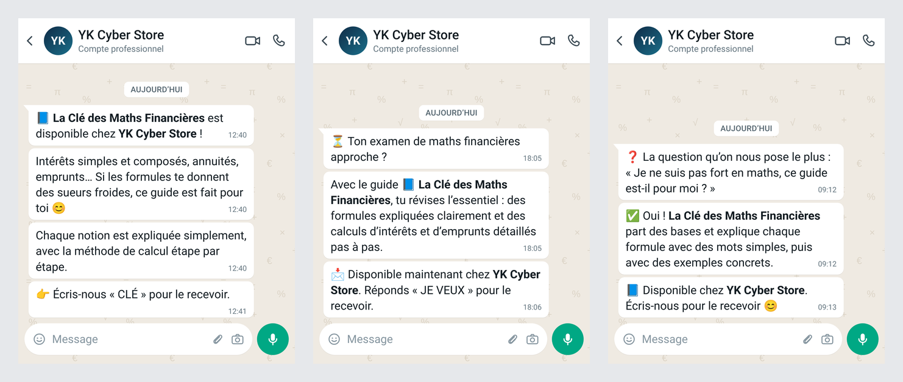

# YK Cyber Store : messages WhatsApp pour « La Clé des Maths Financières »

Trois messages promo de la boutique en images de conversation WhatsApp (1080 × 1350), vues depuis le téléphone
d'un client. Seule la boutique parle : aucun avis de client n'est inventé.



| Image | Message |
| --- | --- |
| `whatsapp/YK-Cyber-Store_message-1-declic.png` | Le guide est disponible : intérêts, annuités, emprunts expliqués étape par étape |
| `whatsapp/YK-Cyber-Store_message-2-examen.png` | L'examen approche : réviser l'essentiel avec le guide |
| `whatsapp/YK-Cyber-Store_message-3-question.png` | La question la plus posée : « ce guide est-il pour moi ? » |

Les textes et les heures sont dans `MESSAGES` en tête de `tools/make_whatsapp.py` (`*texte*` s'affiche en gras) :

```bash
python3 -I marketing/yk-cyber-store/tools/make_whatsapp.py
```

Pour les témoignages, on utilise les vraies captures des clients qui ont répondu, avec leur accord, en masquant
leur numéro et leur photo.

Police : Roboto (licence SIL OFL 1.1, `fonts/`) ; émojis : Noto Color Emoji du système.
