# Plan de production — BIKINIS SHOP / @daya_na990

## Périmètre et sources

Adaptation des 14 séquences de la vidéo fournie à la boutique TikTok déjà montrée dans la conversation. Les captures de boutique montrent des mannequins dorés et noirs, des bikinis colorés, un modèle bleu fleuri avec une fleur blanche et des fonds chauds. Le décor luxueux, les interfaces et les produits des planches sont des illustrations générées pour la maquette, pas des photos vérifiées du catalogue ni une photographie du lieu réel.
La référence automobile a servi au parcours et au vocabulaire du mouvement. Les scènes d’avis, de livraison et de clé deviennent sélection favorite, détail du produit et contact par message. La publicité ne reprend pas de promesse de sécurité, prix, stock, délai, livraison, avis ou chiffre social non fourni.

## Format et timing

Master proposé : 1080 × 1920, 30 i/s, 794 images, 26.466667 s. Les timecodes de la référence étaient approximatifs ; cette nouvelle timeline est une proposition de montage exacte, avec des limites sur des images entières. Les fins sont exclusives dans le JSON.
| Scène | Temps | Images | Fonction | Texte principal |
|---|---|---|---|---|
| S01 | 0.00–1.80 s | 0–53 | Ouverture produit | VOTRE PROCHAIN / COUP DE CŒUR. |
| S02 | 1.80–3.80 s | 54–113 | Recherche TikTok | TROUVEZ / VOTRE STYLE |
| S03 | 3.80–5.30 s | 114–158 | Profil de la boutique | BIKINIS. / COULEURS. STYLE. |
| S04 | 5.30–7.80 s | 159–233 | Sélection dans la galerie | LEQUEL / VOUS PLAÎT ? |
| S05 | 7.80–9.60 s | 234–287 | Question par message | UN MODÈLE / VOUS PLAÎT ? |
| S06 | 9.60–11.80 s | 288–353 | Produit héros en profondeur | VOTRE / COUP DE CŒUR. |
| S07 | 11.80–13.90 s | 354–416 | Détails du modèle | LES DÉTAILS / FONT LE STYLE. |
| S08 | 13.90–17.80 s | 417–533 | Choix du modèle | VOTRE STYLE. / VOTRE CHOIX. |
| S09 | 17.80–19.00 s | 534–569 | Showroom virtuel | LA BOUTIQUE / DANS VOTRE POCHE. |
| S10 | 19.00–20.70 s | 570–620 | Carte de sélection | VOTRE / SÉLECTION |
| S11 | 20.70–21.90 s | 621–656 | Photo du modèle | LE MODÈLE / EN DÉTAIL |
| S12 | 21.90–23.00 s | 657–689 | Contact par message | UN MESSAGE / POUR COMMENCER. |
| S13 | 23.00–25.50 s | 690–764 | Signature et appel à l’action | VOTRE PROCHAIN LOOK / COMMENCE ICI. |
| S14 | 25.50–26.47 s | 765–793 | Raccord de boucle | Sans texte |

## Direction artistique

Fond charbon #181421, typographie crème #FFF3E8, contours et halo corail #FF4269, accents dorés. Titres en serif capitale, interfaces en sans serif. Polices de remplacement livrées localement : DejaVu Serif et DejaVu Sans. Les titres sont recomposés en texte éditable, jamais repris comme pixels flous de la planche.
Format final vertical ; titres environ 64–80 px, handle 44–50 px, UI 28–36 px. Marges de départ : 80 px à gauche, 180 px à droite, 120 px en haut, 250 px en bas. Les coordonnées ci-dessous sont proposées pour le master, pas mesurées dans les images. Valider les zones d’interface TikTok sur téléphone.
Les images individuelles sont découpées des planches à leur résolution native. Les panneaux générés ne sont pas tous exactement en 9:16. Ils servent de références visuelles : reconstruire la scène dans le master, préserver les proportions des produits et ne pas étirer les panneaux pour remplir l’écran.

## Structure et mouvement

Une sous-composition par scène ; caméra sur le parent, apparitions sur les enfants. Une photo continue d’une scène à l’autre conserve sa forme et ses coins arrondis. Entrées courantes en 8–18 images ; sorties en 6–12 images ; décalages de 2–3 images. Courbes proposées : power3.out / power4.out en entrée, power3.in en sortie, sine.inOut pour mouvements doux. Valeurs de réalisation, pas valeurs extraites de la référence.
Les poses de lecture priment sur les effets. Pas de rebond sur tous les éléments, rotation permanente, texte illisible ou zoom qui coupe le mannequin. Le contact final est lisible à partir de 23,3 s et jusqu’à 25,3 s, soit 2 secondes complètes.

## Détail des scènes

### S01 — Ouverture produit · 0.00–1.80 s

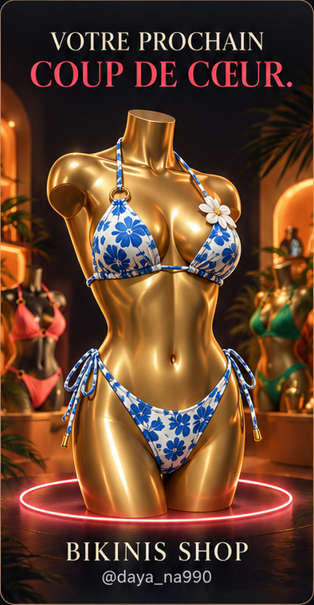

- **Texte :** VOTRE PROCHAIN / COUP DE CŒUR.
- **À construire :** Mannequin doré avec bikini bleu fleuri au centre, cercle corail au sol, boutique chaude en arrière-plan, nom et handle sous le produit.
- **Disposition proposée :** Titre x=80 y=130 w=820 ; mannequin x=160 y=430 w=700 h=940 ; marque et handle y=1430 ; cercle derrière le produit.
- **Calques :** fond-boutique, halo-corail, cercle-sol, mannequin-bleu, titre-ligne-1, titre-ligne-2, nom-boutique, handle.
- **Entrée :** 0–12 images : apparition du halo et du produit, échelle 0,92→1 et opacité 0→1. Titre en deux groupes décalés de 3 images.
- **Pose :** Images 12–44 : produit stable ; légère variation du halo seulement.
- **Sortie :** Images 44–54 : cercle vers avatar ; produit réduit dans le résultat de recherche.
- **Raccord :** Le cercle de lumière devient le contour corail de la recherche.
- **Son proposé :** 0.17 s : impact doux, 1.53 s : souffle court.

### S02 — Recherche TikTok · 1.80–3.80 s

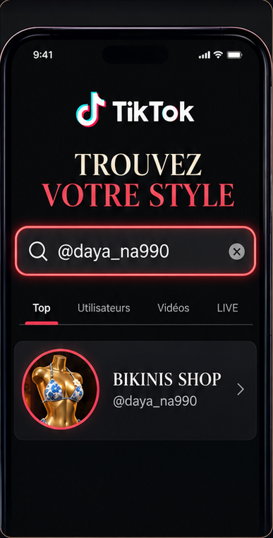

- **Texte :** TROUVEZ / VOTRE STYLE
- **À construire :** Téléphone stylisé avec champ @daya_na990, onglets et un résultat BIKINIS SHOP. Aucun compteur social.
- **Disposition proposée :** Titre x=80 y=130 ; téléphone x=160 y=420 w=700 h=1160 ; champ x=215 y=790 w=580 h=115 ; résultat y=1040.
- **Calques :** telephone, ecran, titre, champ-recherche, icone-recherche, texte-saisi, onglets, resultat, avatar, nom-compte.
- **Entrée :** 0–10 images : arrivée du téléphone. Images 10–28 : saisie progressive du handle ; 28–36 : résultat révélé.
- **Pose :** Images 36–50 : résultat lisible, sans mouvement parasite.
- **Sortie :** Images 50–60 : résultat agrandi vers le profil.
- **Raccord :** Conserver avatar et handle entre le résultat et le profil.
- **Son proposé :** 2.20 s : clic de champ, 2.47 s : saisie légère, 3.47 s : clic de sélection.

### S03 — Profil de la boutique · 3.80–5.30 s

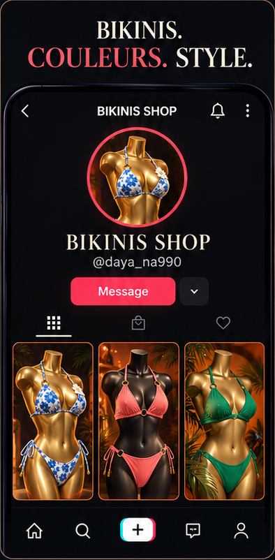

- **Texte :** BIKINIS. / COULEURS. STYLE.
- **À construire :** Profil BIKINIS SHOP, @daya_na990, bouton Message, trois photos illustratives bleu, rose et vert sur mannequins.
- **Disposition proposée :** Titre x=80 y=130 ; téléphone x=170 y=420 w=680 h=1160 ; bouton Message centré dans le profil ; grille sous le bouton.
- **Calques :** telephone, avatar, nom-boutique, handle, bouton-message, onglets, produit-bleu, produit-rose, produit-vert, titre.
- **Entrée :** 0–10 images : profil remplace le résultat ; grille entre avec un décalage de 2 images par carte.
- **Pose :** Images 10–35 : profil et bouton lisibles.
- **Sortie :** Images 35–45 : descente vers la grille ; produit bleu mis en avant.
- **Raccord :** La même carte bleue est utilisée dans la grille et dans la scène suivante.
- **Son proposé :** 3.97 s : clic bref.

### S04 — Sélection dans la galerie · 5.30–7.80 s

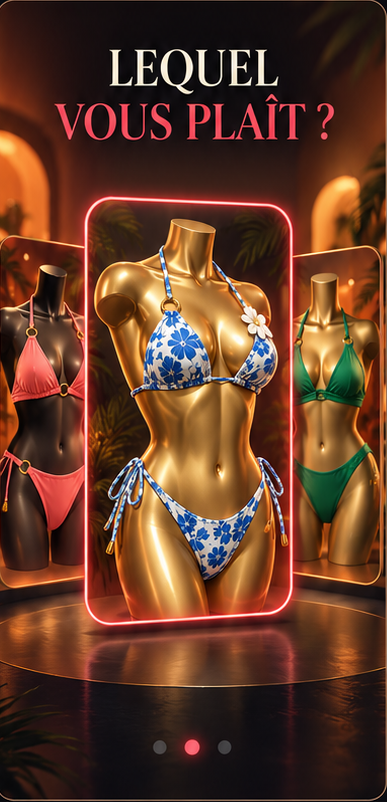

- **Texte :** LEQUEL / VOUS PLAÎT ?
- **À construire :** Trois cartes produit : bleu fleuri devant, rose et vert en retrait. Contour corail sur la sélection.
- **Disposition proposée :** Titre x=80 y=130 ; carte centrale x=200 y=500 w=630 h=960 ; cartes latérales plus petites ; fond assombri.
- **Calques :** fond, carte-rose, carte-verte, carte-bleue, contour-selection, pagination, titre.
- **Entrée :** 0–18 images : carte bleue passe au premier plan, échelle 0,65→1 ; les cartes latérales reculent et perdent du contraste.
- **Pose :** Images 18–63 : produit lisible ; déplacement doux de caméra limité.
- **Sortie :** Images 63–75 : carte réduite vers la photo jointe au message.
- **Raccord :** Même image, même coin arrondi ; trajectoire vers la messagerie.
- **Son proposé :** 5.70 s : souffle de carte, 7.30 s : sélection douce.

### S05 — Question par message · 7.80–9.60 s

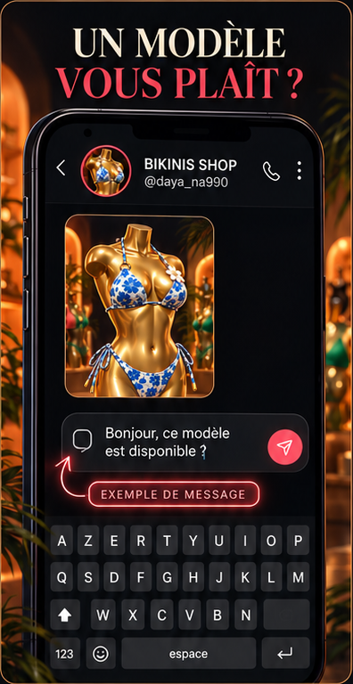

- **Texte :** UN MODÈLE / VOUS PLAÎT ?
- **À construire :** Écran de message avec photo bleue, brouillon « Bonjour, ce modèle est disponible ? », clavier et mention EXEMPLE DE MESSAGE.
- **Disposition proposée :** Titre x=80 y=130 ; téléphone x=170 y=440 w=680 h=1180 ; photo au-dessus du brouillon ; clavier contenu dans le téléphone.
- **Calques :** telephone, nom-boutique, avatar, photo-bleue, champ-message, texte-question, bouton-envoi, clavier, mention-exemple, titre.
- **Entrée :** 0–10 images : photo et messagerie apparaissent. Images 10–34 : texte saisi progressivement.
- **Pose :** Images 34–44 : brouillon lisible ; aucune réponse de boutique inventée.
- **Sortie :** Images 44–54 : séparation de la photo et des panneaux pour le reveal.
- **Raccord :** La photo, le champ et la vignette deviennent les plans du produit héros.
- **Son proposé :** 8.30 s : saisie légère, 9.20 s : clic de bouton.

### S06 — Produit héros en profondeur · 9.60–11.80 s

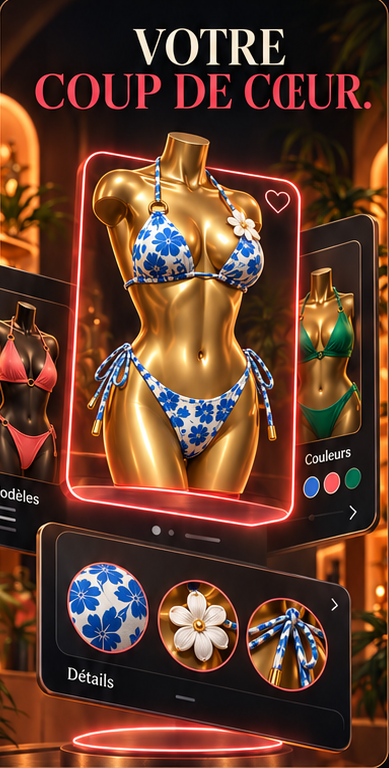

- **Texte :** VOTRE / COUP DE CŒUR.
- **À construire :** Mannequin bleu fleuri principal détaché, cartes rose et verte en arrière-plan, carte de détails en dessous, contours corail.
- **Disposition proposée :** Titre x=80 y=130 ; héros x=200 y=450 w=630 h=930 ; détails x=150 y=1370 w=750 h=230 ; perspective commune modérée.
- **Calques :** fond, halo, carte-rose, carte-verte, ombre-heros, heros-detoure, contour-heros, carte-details, titre.
- **Entrée :** 0–18 images : inclinaison de la scène, plans séparés ; héros avance et monte. Perspective commune, transformations des enfants indépendantes.
- **Pose :** Images 18–54 : pose produit et profondeur ; pas de rotation permanente.
- **Sortie :** Images 54–66 : raccord vers le tissu et la fleur.
- **Raccord :** Un détail de la carte basse devient le gros plan suivant.
- **Son proposé :** 9.87 s : souffle ample et grave discret.

### S07 — Détails du modèle · 11.80–13.90 s

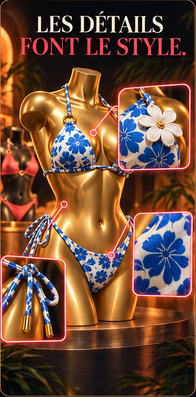

- **Texte :** LES DÉTAILS / FONT LE STYLE.
- **À construire :** Produit entier avec trois détails : fleur blanche, motif bleu et liens latéraux. Les gros plans sont illustratifs.
- **Disposition proposée :** Titre x=80 y=130 ; produit x=120 y=440 w=620 h=1080 ; inserts à droite et en bas ; traits fins reliant les détails.
- **Calques :** produit, insert-fleur, insert-tissu, insert-liens, contours, traits-reperes, titre.
- **Entrée :** 0–15 images : ouverture des inserts, décalage de 3 images ; traits dessinés après les cadres.
- **Pose :** Images 15–51 : un zoom lent sur le produit, inserts stables et lisibles.
- **Sortie :** Images 51–63 : inserts se replient vers les widgets de choix.
- **Raccord :** Les cadres de détails deviennent les cadres de sélection.
- **Son proposé :** 12.00 s : souffle léger, 12.30 s : pop doux de détail.

### S08 — Choix du modèle · 13.90–17.80 s

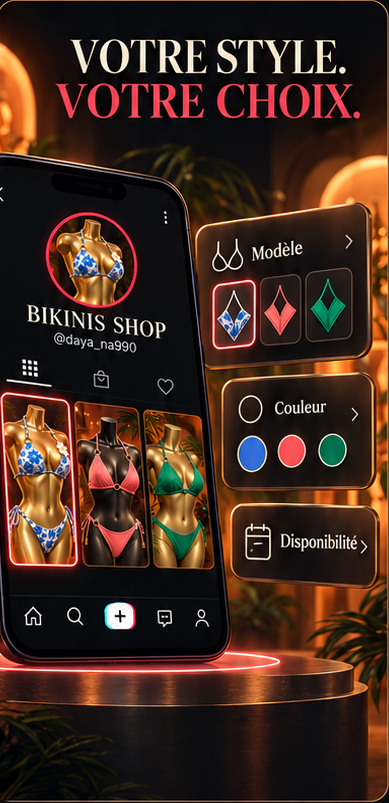

- **Texte :** VOTRE STYLE. / VOTRE CHOIX.
- **À construire :** Téléphone avec collection, widgets Modèle, Couleur, Disponibilité. Il s’agit d’options de demande, sans confirmation de stock.
- **Disposition proposée :** Titre x=80 y=130 ; téléphone x=90 y=540 w=520 h=1030 ; widgets x=620 y=620 w=300 h=220, 890 et 1160.
- **Calques :** telephone, collection, widget-modele, widget-couleur, widget-disponibilite, selection-bleue, cercle-sol, titre.
- **Entrée :** 0–18 images : téléphone entre ; widgets arrivent aux images 18, 24 et 30.
- **Pose :** Images 30–99 : pose de lecture ; seule la sélection bleue pulse brièvement.
- **Sortie :** Images 99–117 : caméra avance et les widgets cadrent le showroom.
- **Raccord :** Téléphone et halo restent continus pendant la révélation de la boutique virtuelle.
- **Son proposé :** 14.50 s : clic Modèle, 14.70 s : clic Couleur, 14.90 s : clic Disponibilité.

### S09 — Showroom virtuel · 17.80–19.00 s

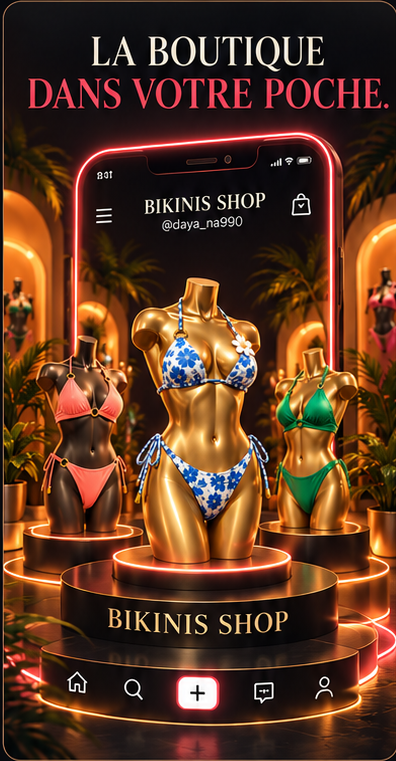

- **Texte :** LA BOUTIQUE / DANS VOTRE POCHE.
- **À construire :** Trois mannequins sur podiums dans une boutique virtuelle encadrée par un téléphone. Décor illustratif, sans adresse physique annoncée.
- **Disposition proposée :** Titre x=80 y=130 ; showroom x=120 y=490 w=820 h=1090 ; mannequin bleu central ; rose et vert latéraux plus petits.
- **Calques :** decor-virtuel, cadre-telephone, podium-central, podium-gauche, podium-droit, mannequins, enseignes, halos, titre.
- **Entrée :** 0–12 images : podiums et mannequins se révèlent ; légère ouverture de l’angle de caméra.
- **Pose :** Images 12–27 : vue complète stable.
- **Sortie :** Images 27–36 : showroom recule légèrement pour laisser entrer la sélection.
- **Raccord :** Le showroom reste visible sous la carte favorite.
- **Son proposé :** 17.93 s : souffle de reveal.

### S10 — Carte de sélection · 19.00–20.70 s

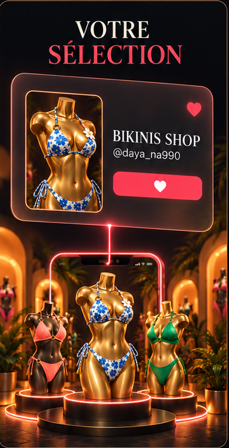

- **Texte :** VOTRE / SÉLECTION
- **À construire :** Carte translucide avec produit bleu, nom BIKINIS SHOP, handle et cœur ; showroom dessous. Aucun témoignage ou classement.
- **Disposition proposée :** Titre x=80 y=130 ; carte x=120 y=470 w=820 h=520 ; showroom réduit sous y=1080 ; cœur corail dans la carte.
- **Calques :** showroom, carte-selection, photo-produit, nom-boutique, handle, bouton-coeur, trait-lumineux, titre.
- **Entrée :** 0–12 images : carte entre au-dessus du showroom ; image et nom entrent ensuite.
- **Pose :** Images 12–41 : sélection stable ; cœur animé une seule fois.
- **Sortie :** Images 41–51 : photo de la carte grandit vers le plan produit suivant.
- **Raccord :** Même image et mêmes coins arrondis entre la sélection et le modèle en détail.
- **Son proposé :** 19.60 s : pop favori.

### S11 — Photo du modèle · 20.70–21.90 s

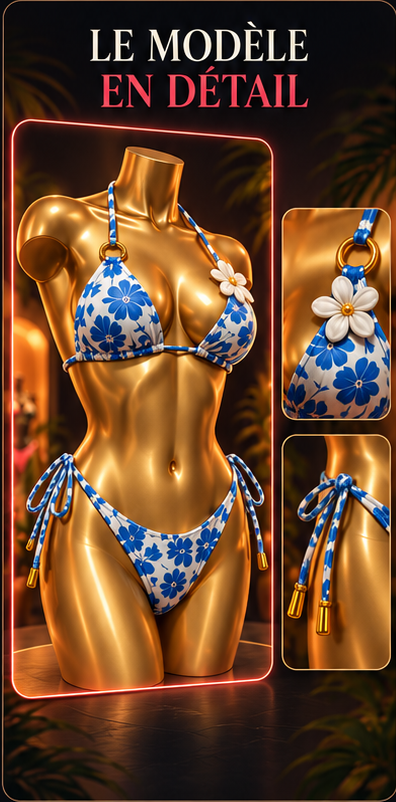

- **Texte :** LE MODÈLE / EN DÉTAIL
- **À construire :** Grande carte du mannequin bleu et deux inserts de fleur et liens. Dans le final, ils proviendront de vraies photos du même article.
- **Disposition proposée :** Titre x=80 y=130 ; grande carte x=100 y=450 w=620 h=1120 ; inserts x=750 y=600 et y=1030 w=200.
- **Calques :** photo-principale, cadre-principal, detail-fleur, detail-liens, titre, fond.
- **Entrée :** 0–10 images : grande carte arrive ; deux inserts suivent avec 2 images de décalage.
- **Pose :** Images 10–27 : modèle stable, détail reconnaissable.
- **Sortie :** Images 27–36 : carte devient la miniature près du bouton Message.
- **Raccord :** La miniature reste le même produit jusqu’au contact.
- **Son proposé :** 20.90 s : souffle court.

### S12 — Contact par message · 21.90–23.00 s

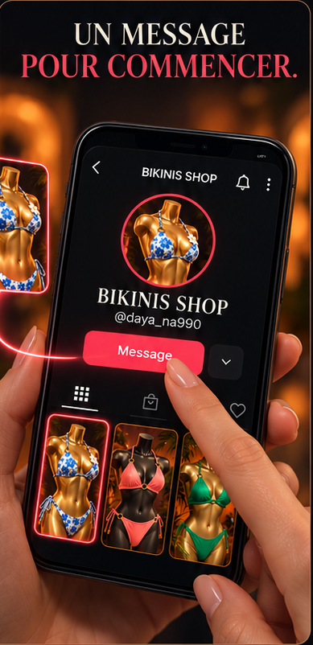

- **Texte :** UN MESSAGE / POUR COMMENCER.
- **À construire :** Main appuyant sur Message dans le profil, produit bleu en vignette, trace corail. Aucun achat confirmé ni paiement montré.
- **Disposition proposée :** Titre x=80 y=130 ; téléphone x=280 y=560 w=620 h=1060 ; vignette x=90 y=600 w=230 h=360 ; point de tap dans le bouton.
- **Calques :** telephone, profil, bouton-message, main, vignette-produit, trace-corail, titre.
- **Entrée :** 0–6 images : téléphone et vignette se placent. Images 6–18 : doigt rejoint le bouton et le bouton réagit.
- **Pose :** Images 18–24 : résultat visuel du contact, sans échange ou promesse inventée.
- **Sortie :** Images 24–33 : trace corail rejoint le cercle de la signature.
- **Raccord :** Trace vers cercle ; vignette vers produit de la signature.
- **Son proposé :** 22.40 s : clic Message, 22.80 s : souffle de signature.

### S13 — Signature et appel à l’action · 23.00–25.50 s

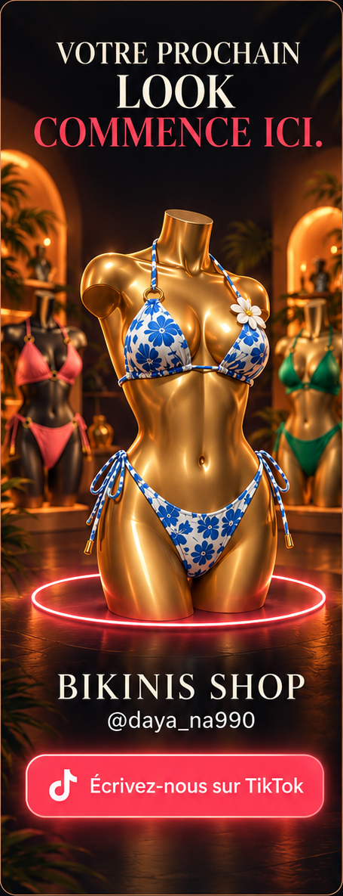

- **Texte :** VOTRE PROCHAIN LOOK / COMMENCE ICI.
- **À construire :** Produit bleu, BIKINIS SHOP, @daya_na990 et bouton « Écrivez-nous sur TikTok ». Priorité à la lecture du contact.
- **Disposition proposée :** Titre x=80 y=130 w=820 ; produit x=240 y=480 w=570 h=820 ; nom/handle y=1340/1430 ; CTA x=90 y=1530 w=780 h=120.
- **Calques :** fond, cercle-sol, produit-bleu, titre, nom-boutique, handle, bouton-cta, icone-message.
- **Entrée :** 0–9 images : signature apparaît, CTA en place au plus tard à l’image 9 de cette scène.
- **Pose :** Images 9–69 : CTA et handle totalement lisibles ; mouvement du produit presque nul.
- **Sortie :** Images 69–75 : textes disparaissent, halo se concentre sur le produit.
- **Raccord :** Le halo devient le cercle du raccord final.
- **Son proposé :** 23.10 s : signature sonore douce.

### S14 — Raccord de boucle · 25.50–26.47 s

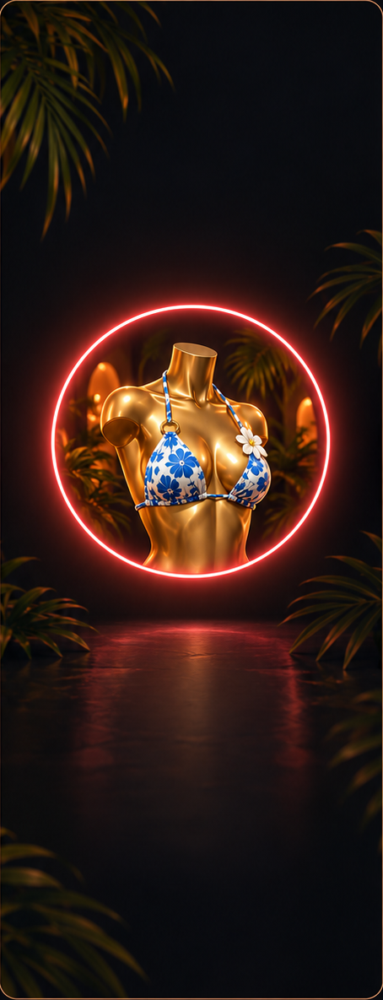

- **Texte :** Aucun titre.
- **À construire :** Produit bleu dans un cercle corail sur fond sombre, sans titre. Un état intermédiaire guide le retour à l’ouverture.
- **Disposition proposée :** Cercle et vignette au centre ; dernier état aligné avec le premier cadre d’ouverture, pas avec le cadre de maquette figé.
- **Calques :** fond, cercle-corail, produit-bleu, halo.
- **Entrée :** 0–10 images : cercle et vignette prennent la place de la signature.
- **Pose :** Images 10–20 : contraction douce et rapprochement de la pose initiale.
- **Sortie :** Images 20–29 : position, échelle et lumière convergent vers l’état de départ.
- **Raccord :** Comparer les images 793 et 0 pour réduire la rupture ; un fondu seul ne garantit pas le raccord.
- **Son proposé :** 25.90 s : souffle inversé discret.

## Son

Le son témoin fourni est une création synthétique originale de 26,4667 s, stéréo 48 kHz. Il montre le rythme et les accents ; ce n’est pas la bande-son TikTok ni une musique identifiée. Le 120 BPM est proposé. Dans un film final, une musique autorisée peut le remplacer ; les effets sont synchronisés aux marqueurs JSON. Pas de voix off par défaut. Cible de mix final autour de −16 LUFS intégrés, crête vraie ≤ −1 dBTP, à mesurer après encodage.

## Assets nécessaires au rendu catalogue fidèle

Trois photos produit HD : bleu fleuri, rose et vert ; un détail du bleu ; avatar/logo de boutique si disponible ; photo principale ou détourage du produit. Les images de cette maquette ne prouvent ni la coupe exacte, ni la couleur exacte, ni la disponibilité. Les captures originales de boutique sont dans la conversation et ne sont pas disponibles comme fichiers locaux dans ce paquet.

## Livraison attendue de Claude Code

Projet éditable HyperFrames/GSAP ou autre moteur déterministe justifié ; vidéo H.264 1080 × 1920 à 30 i/s, audio AAC stéréo 48 kHz ; sources et assets locaux ; 14 captures de contrôle ; contrôle du début, des raccords et de la dernière image. Un film utilisant les visuels illustratifs reste une maquette. Une publicité catalogue finale nécessite les photos originales.
