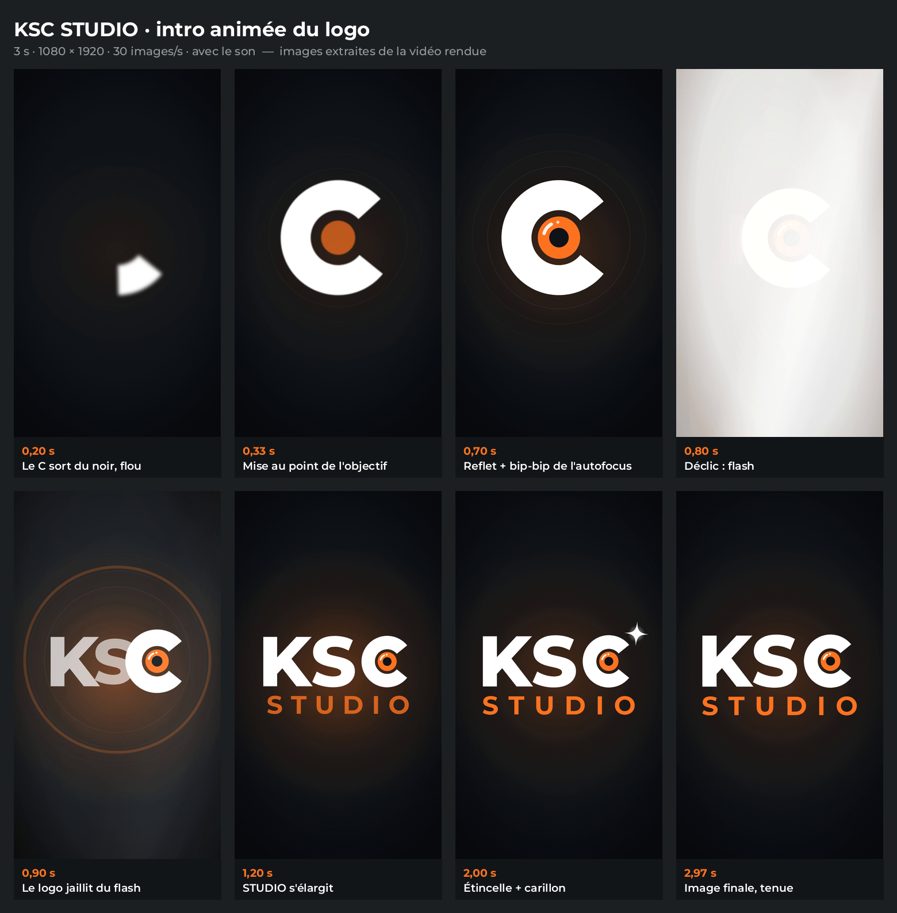

# KSC STUDIO : intro animée du logo (3 s)

Intro verticale 1080×1920, 30 i/s, 90 images (3 s), avec le son, faite avec [HyperFrames](https://hyperframes.heygen.com)
pour le logo retenu A · Objectif (`brand/ksc-studio/`). Elle se place au début des Reels, TikTok et stories ; la
dernière seconde tient le logo pour enchaîner sur la vidéo.



## Déroulé

| Temps | Image | Son |
| --- | --- | --- |
| 0 → 0,65 s | L'objectif (le C du logo) se dessine en grand et fait sa mise au point | Montée, moteur d'autofocus |
| 0,6 → 0,75 s | Le reflet s'allume sur le verre | Bip-bip de l'autofocus |
| 0,75 → 0,8 s | Déclic : flash blanc | Double déclic d'obturateur, impact sourd |
| 0,78 → 1,3 s | Sous le flash, l'objectif file à sa place ; K et S jaillissent du même point ; une onde orange s'ouvre | Souffle |
| 1,0 → 1,6 s | STUDIO s'élargit | Nappe chaude en fa majeur |
| 1,9 → 2,4 s | Étincelle au-dessus du C | Carillon |
| 2,4 → 3 s | Tenue du logo | Fondu jusqu'au silence |

## Structure

| Fichier | Rôle |
| --- | --- |
| `index.html` | Hôte : monte le logo animé, le flash et le son |
| `compositions/ksc-logo.html` | Le logo découpé en pièces animées (K, S, objectif, lettres de STUDIO) et son animation GSAP |
| `compositions/editorial-flash-overlay.html` | Flash d'appareil photo : bloc du catalogue HyperFrames adapté au vertical, centré sur l'objectif et calé sur le déclic |
| `assets/audio/ksc-intro-son.wav` | Bruitages et nappe synthétisés (aucun son externe), −16 LUFS, crête ≤ −1 dBTP |
| `assets/vendor/gsap.min.js` | GSAP 3.14.2 en local, pour un rendu hors ligne |
| `assets/ksc-vertical-negatif.svg` | Logo de référence (version négatif du kit) ; `assets/index.md` dit d'où vient chaque fichier |
| `shot-plan.json` | Plan d'animation : temps, mouvements, son |
| `renders/KSC_STUDIO_intro-logo.mp4` | Vidéo rendue (H.264, AAC 48 kHz), aussi copiée dans le kit : `brand/ksc-studio/kit-objectif/6_video/` |
| `captures/ksc-intro-planche.png` | Planche de revue : 8 images de la vidéo, légendées (`tools/planche.py`) |

## Modifier et régénérer

`index.html`, `compositions/ksc-logo.html` et le son sont écrits par `tools/build_intro.py` : on modifie le script, pas
ces fichiers. Les pièces du logo y sont recalculées avec les mêmes réglages que `brand/ksc-studio/tools/make_logos.py`.

- **Mouvements et temps** : le script de `LOGO`, étapes 1 à 6 commentées (temps en secondes) ; `LOGO_W` règle la largeur
  finale du logo, `HERO` la position et le rayon de l'objectif en grand plan.
- **Son** : `build_audio()`, un bruitage par ligne avec son temps de départ.

```bash
python3 -I videos/ksc-studio-intro/tools/build_intro.py         # composition et son
(cd videos/ksc-studio-intro && npx --yes hyperframes@0.8.181 check)
(cd videos/ksc-studio-intro && npx --yes hyperframes@0.8.181 render . -q high -o renders/KSC_STUDIO_intro-logo.mp4)
python3 -I videos/ksc-studio-intro/tools/planche.py             # planche de revue
python3 -I brand/ksc-studio/tools/make_kit.py --paquet          # remet l'intro dans le kit et dans le ZIP
```
